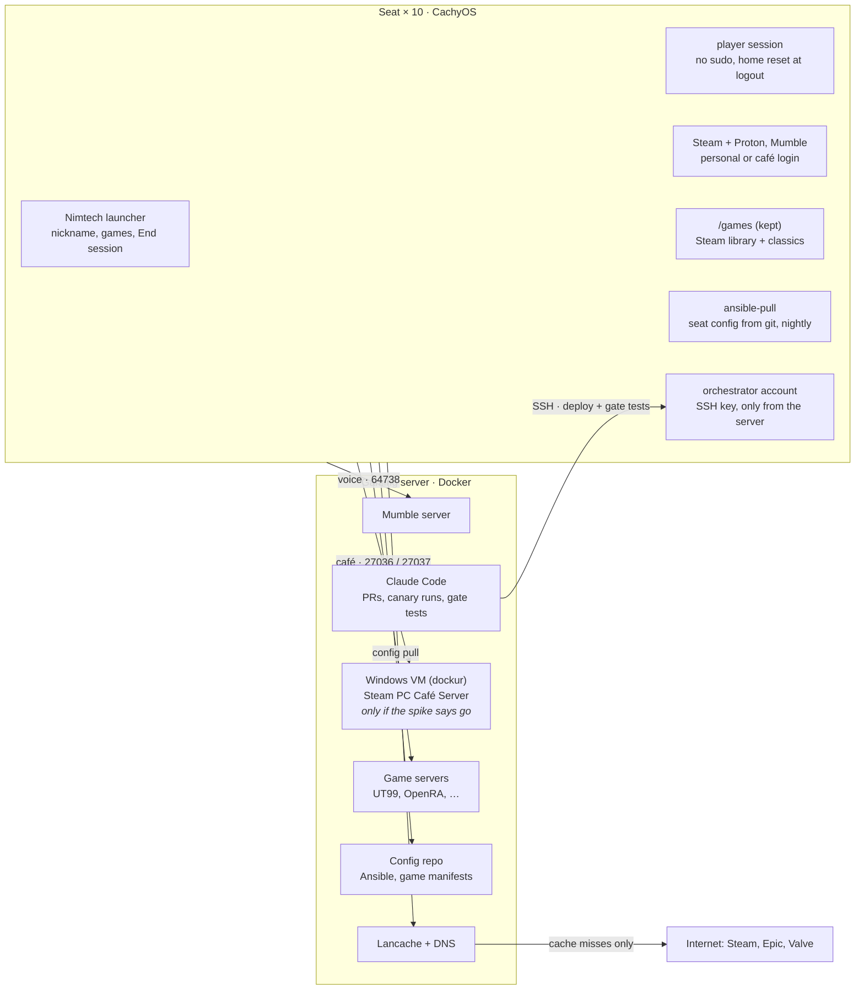

# Gaming Room on CachyOS – Project Scope

The gaming room becomes plug-and-play on the CachyOS it already runs: ten seats managed as code, a guest session that wipes itself on logout, one launcher that starts any game tuned for the seat, and one server for voice, download caching and Steam PC Café. None of this depends on the OS debate; the same work is needed on any OS.

## Goals, non-goals and success criteria

The goal is a room where anyone sits down, types a name and is in a game with voice in under a minute, and leaves nothing behind when they go.

**Goals**

- **Plug and play:** power on, pick a name, pick a game. No passwords, no setup dialogs, no hunting for files.
- **Clean in, clean out:** personal logins (Steam, Epic, Discord, browser) never survive a logout.
- **Identical seats:** every seat is built from the same code; a broken seat is rebuilt, not repaired.
- **One launcher:** every game, classic or Steam, starts from the same screen, tuned to that seat's hardware.
- **Voice that just works:** everyone lands in the same low-latency channel automatically.
- **Share once, play everywhere:** a game is downloaded once and reaches every seat at LAN speed.

**Non-goals**

- Re-opening Windows vs Linux. The seats stay on CachyOS; only the PC Café server needs Windows, and it runs as a VM on the server.
- Games that require kernel-level anti-cheat. They are best effort, never a requirement.
- Per-person accounts on the seats. One shared player account that resets is simpler and safer.

**Success criteria (proposed)**

| Criterion | Target | How we test it |
| --- | --- | --- |
| Power on to in a classic LAN match | Under 60 s, zero dialogs | Stopwatch, any seat |
| Logout leaves no personal tokens | 0 files found | Script checks known token paths after logout |
| Seat rebuilt from scratch | Under 30 min, hands-off after install | Wipe one seat, run the playbook |
| All seats in voice | 10 of 10 in one channel within 10 s of picking a name | Game night head count |
| Second install of a Steam game | Served from the local cache | Lancache log shows a cache HIT |
| Player account cannot change the system | `sudo` and package installs refused | Try it on a seat |

## Architecture at a glance

Each seat is identical and disposable; everything shared lives on one server on the same VLAN, and only cache misses go out to the internet.

## Seats: CachyOS baseline managed as code

- **Config as code:** this repo holds packages, users, session scripts, the launcher and the game manifests. Each seat runs `ansible-pull` on boot and nightly. A change is a pull request, not a visit to the room.
- **Accounts per seat:**
    - `admin`: in `wheel`, SSH key login only, no password login at the seat.
    - `player`: no `wheel`, no `sudo`, auto-login via SDDM. A polkit rule allows shutdown and reboot only.
    - `orchestrator`: SSH key from the server only; used by Ansible and Claude.
- **Hardware tiers:** a boot script reads GPU, RAM and display and writes the tier (A, B or C) to `/etc/seat/tier`. CachyOS's `chwd` keeps choosing drivers.
- **Disk layout (btrfs where possible):** `/home/player` is its own subvolume, reset from a golden snapshot. All ten seats were installed on ext4 instead (found during rollout, November 2026), so resets copy the golden home: about 1.2 s on seat-01. Switch to btrfs only at a reinstall. `/games` is its own subvolume and is kept: Steam library in `/games/steam`, classic games read-only in `/games/classic`.
- **Updates on our schedule:** updates run only from the playbook in a set window. The canary seat goes first; the rest follow a day later. A btrfs snapshot is taken before every update. No updates in the 48 h before a game night.
- **Power:** Wake-on-LAN, so the server can start all seats before a session.

## Getting in and out: the session lifecycle

The player's home is thrown away and recreated from a golden snapshot at every logout and every boot.

1. **Boot:** `seat-reset.service` recreates `/home/player` from `/home/.golden/player` with `btrfs subvolume snapshot`.
2. **Auto-login:** SDDM logs in `player` and the launcher opens full screen.
3. **Who are you?** The launcher asks for a nickname once and writes it into Mumble and every game.
4. **Play:** classic games start directly. Steam opens only if the person signs in.
5. **End session:** the End session button, or 20 min idle after a 60 s warning. Games close, `steam -shutdown` runs, and `seat-reset.service` runs.
6. **Ready again:** back at step 2 with a clean home.

| Data | Where it lives | After End session |
| --- | --- | --- |
| Steam login and Steam Guard tokens | `~/.local/share/Steam`, `~/.steam` | Wiped (home reset) |
| Epic, GOG (Heroic), Battle.net, Discord, browser logins | `~` | Wiped (home reset) |
| Classic game settings and Wine prefixes | `~` | Back to golden defaults |
| Proton prefixes (Steam saves on Windows games) | `/games/steam/steamapps/compatdata` | Wiped; Steam Cloud restores saves |
| Installed Steam games | `/games/steam/steamapps/common` | Kept |
| Shader cache | `/games/steam/steamapps/shadercache` | Kept |
| Classic game files | `/games/classic` | Kept, read-only |

## One launcher to bind them all

A thin launcher of our own on top of proven runners: the launcher owns the experience; `umu-launcher` with GE-Proton, native ports, `gamescope` and `gamemode` do the running. See [launcher/README.md](../launcher/README.md) and [games/README.md](../games/README.md).

- **Look and feel:** Fluent 2 design (Mica, Acrylic, the Fluent type ramp and motion). Ease of use comes first: pick a game, press Play. Works with keyboard, mouse and gamepad. See [launcher/DESIGN.md](../launcher/DESIGN.md).
- **Direct:** intros skipped, player name set, full screen at native resolution, straight into the menu or a server.
- **Tuned:** settings rendered from templates at launch, using the seat's tier and display.
- **Old low-resolution games:** inside `gamescope` with integer scaling.
- **Windows-only titles:** `umu-run` with a pinned GE-Proton, prefix preinstalled in the golden home.

## Game catalogue

| Game | Route on CachyOS | LAN play | To confirm |
| --- | --- | --- | --- |
| Command & Conquer, Red Alert | OpenRA (native, free engine) | OpenRA server on the gaming server | Whether anyone wants the original binaries too |
| Warcraft | Warcraft II: Wargus (native, uses original data). Warcraft III: Proton | Broadcast discovery inside one VLAN | Which Warcraft and edition we own |
| Unreal Tournament (99) | OldUnreal 469e, native Linux | Dedicated server | Needs the original data files |
| Unreal Tournament 2004 | Native Linux build or Proton, by testing | Dedicated server | Which runs better on our tiers |
| Call of Duty: Modern Warfare 2 (2009) | IW4x through Proton; game files from the server's share ([runbook](iw4x.md)) | IW4x server on the gaming server, or `+connect` to a seat | One owned Steam copy per seat |
| Steam games | Steam with Proton | Per game | Kernel-level anti-cheat is best effort |
| DOS-era titles | DOSBox Staging; IPX over UDP | DOSBox IPX server | Which ones we want |

## The server

See [server/README.md](../server/README.md). The old laptop qualifies only with VT-x or AMD-V, 16 GB+ RAM, room for 1–2 TB SSD and wired gigabit. Server and seats share one subnet, which Valve's PC Café setup requires and old-game discovery relies on.

## Steam PC Café

Only the central server must run Windows, but Valve's documentation does not say whether Linux seats can use the café license pool, so this is a spike with a go/no-go before we buy anything.

**Confirmed in Valve's Steamworks documentation:** server on Windows 10+ or Server 2016+; about 1 TB if used as a content cache; server and seats on the same subnet (UDP 27036 broadcast, TCP 27037); players sign in with their own accounts; sign-up needs an NDA, the PC Café Agreement signed by the legal entity, and a new master Steam account that can never buy normal games.

**Unknown:** whether the Linux Steam client can use the café pool; whether Valve accepts an internal company room; what café licenses cost.

**Spike:** ask Valve; if yes or no answer, stand up `dockur/windows` with macvlan, sign one CachyOS seat in, launch one café-licensed title. Go only if a Linux seat can launch a café license.

**If no-go:** Lancache plus personal accounts; DRM-free copies Nimtech owns for shared LAN classics, after checking each license.

## Voice: Mumble

Open source, no license or slot limits, client in the CachyOS repos, Opus codec, and `mumble://` links drop a seat straight into a channel.

- Official `mumble-server` container. The root channel is called Lobby; Team channels are added with the SuperUser account. No server password by default, because the VLAN is closed; one can be set in the private inventory.
- After the nickname step, the launcher starts Mumble with `mumble://<nickname>@<server>/`.
- Mumble's settings are pre-filled in the golden home, so it joins with no wizard or dialog: push-to-talk on the mouse side button (V also works) in every window, which the player can change to another key on the name screen, 10 ms frames, noise suppression on, hidden in the tray. Each seat makes its own certificate. The server's certificate is trusted in advance.
- Golden config: Opus, 10 ms per packet, push-to-talk on one agreed key, noise suppression, audio wizard done.
- One headset per seat, same model if possible.

## Claude as orchestrator and tester

Claude Code runs on the gaming server and works like a team member: it writes changes as pull requests, applies them to the canary seat, and runs the gate tests. People review and merge. Rules are in [CLAUDE.md](../CLAUDE.md).

- Dedicated `claude` user on the server, signed in with a Nimtech Team seat. People reach it from anywhere through Remote Control (Claude app or claude.ai), with no VPN; the server makes outbound HTTPS only. It runs in tmux and starts at boot. Live since 11 November 2026.
- GitHub: a fine-grained token for this repo only (Contents and Pull requests). `main` is not branch-protected by choice; the repo rules and Claude settings forbid pushing to it.
- `orchestrator` account on each seat: SSH key only, accepted only from the server (plus the Mac that drove the first setup).
- The gaming VLAN has no route into the corporate network.
- Every command Claude runs is logged on the server.

## Phased plan

| Phase | Work | Gate |
| --- | --- | --- |
| 0 · Inventory and spike | Log every seat (CPU, GPU, RAM, disk, monitor, headset). Check server hardware. Ask Valve about PC Café on Linux seats. | Server hardware chosen; PC Café go or no-go decided |
| 1 · Seat foundation | Ansible, account split, auto-login, home reset. Update policy. | A wiped seat rebuilds in under 30 min; logout leaves no tokens |
| 2 · Server | Mumble, Lancache + DNS, UT99 and OpenRA servers. Windows VM only if go. | 10 seats in one voice channel; repeat installs come from the cache |
| 3 · Launcher MVP | Manifest-driven grid, nickname, 4 classics, End session, Mumble auto-join, Steam tile. | Power on to in a UT99 match in under 60 s, zero dialogs |
| 4 · Polish | Tiers, LAN lobby, idle logout, Wake-on-LAN, docs. | Someone outside the project adds a game unaided |

Phases 1 and 2 can run in parallel.

## Work packages and roles

| Package | Delivers | Skills |
| --- | --- | --- |
| WP0 Scope lead | Keeps the scope current, runs the gates, books dugnad sessions | Overview, follow-up |
| WP1 Seat baseline | Ansible, accounts, tiers, update policy | Linux, Ansible |
| WP2 Session lifecycle | Golden home, `seat-reset.service`, idle logout, token check | Linux, btrfs, systemd |
| WP3 Server and network | Server hardware, Docker, Mumble, Lancache, DNS, game servers, Wake-on-LAN | Docker, networking |
| WP4 Launcher | Launcher app, manifest format, nickname and Mumble flow | App development |
| WP5 Game packaging | One manifest, tier templates and a LAN test per game | Anyone who loves that game |
| WP6 PC Café and licenses | Valve contact, spike, license list | Someone who can sign for Nimtech |
| WP7 Claude orchestrator | Claude Code on the server, gate scripts, nightly report; drafts code for WP1–WP5 | A person to review and merge |

## Risks

| Risk | Mitigation |
| --- | --- |
| PC Café doesn't support Linux seats, or Valve won't accept an internal room | Spike before buying; fall back to Lancache and personal accounts |
| The old laptop is too weak | Check in Phase 0; budget for a used mini PC |
| A rolling update breaks a game before game night | Canary seat, snapshot before update, 48 h freeze |
| Mixed hardware plays badly on some seats | Tiers; test each game on the weakest seat |
| Kernel-level anti-cheat games | Non-goal; best effort |
| Nobody owns it after launch | Scope lead owns gates; adding a game is a documented PR |
| License terms for one copy on several seats | WP6 checks each game first |

## Sources

- [Steamworks: Setup instructions for the PC Café model](https://partner.steamgames.com/doc/sitelicense/licensees/gettingstarted/licensemodelpc)
- [Steamworks: PC Café requirements and sign-up](https://partner.steamgames.com/doc/sitelicense/licensees/signup)
- [dockur/windows](https://github.com/dockur/windows)
- [GamingOnLinux: Unreal Tournament v469e from OldUnreal](https://www.gamingonlinux.com/2025/11/the-classic-unreal-tournament-gets-a-big-upgrade-with-the-v469e-patch-from-oldunreal)
- [Lancache](https://lancache.net/)
